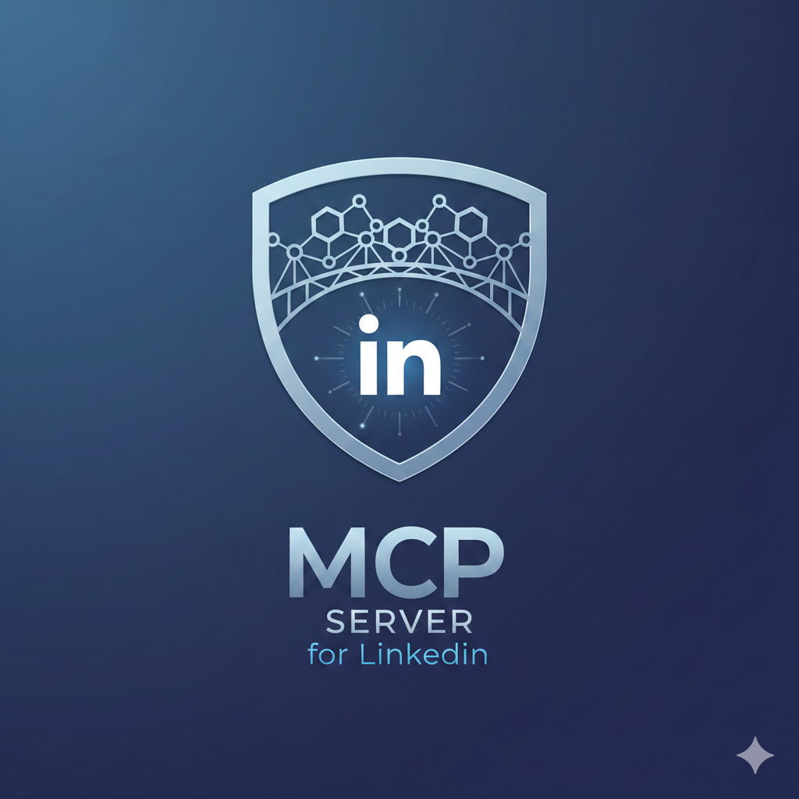
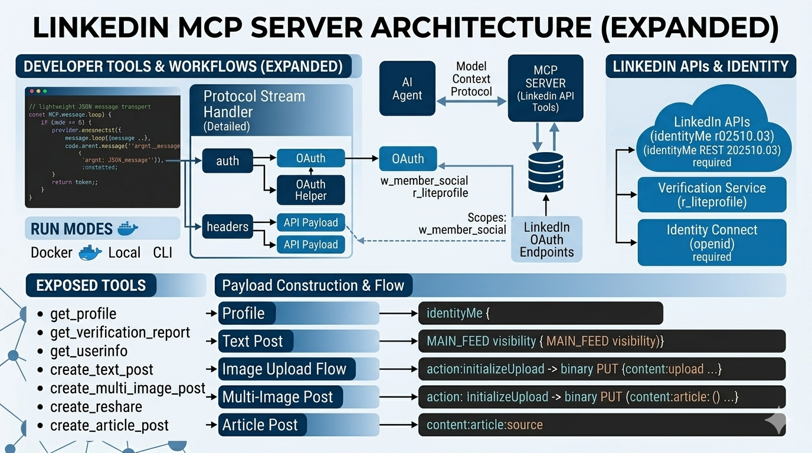

# Understanding MCP Through a Real LinkedIn Integration



If you spend enough time around AI agents, you hear the same promise over and over: agents will not just answer questions, they will do work.

That promise is only partly true if the model cannot safely and reliably interact with real systems.

An agent that cannot use tools is mostly a good conversationalist. An agent that can discover tools, understand their inputs, and execute real actions starts becoming useful.

That is where MCP comes in.

This article uses a real project, the LinkedIn MCP Server, to explain what MCP is, why it matters for agent AI, and how a practical MCP server can expose LinkedIn capabilities like profile lookup, content publishing, image posting, and article sharing.

The project is available on GitHub at `https://github.com/hashan-silva/linkedin-mcp-server`, and the Docker image is published as `hashan0314/linkedin-mcp-server`.



## What MCP Actually Is

MCP stands for Model Context Protocol.

The simplest way to understand it is this: MCP gives AI agents a standard way to use tools.

Without MCP, developers often end up stuffing API instructions into prompts and hoping the model follows them correctly. That approach breaks down quickly. The model may misunderstand the shape of the request, invent parameters, skip required fields, or misuse an external API.

MCP replaces that guesswork with structure.

An MCP server tells an agent:

- what tools exist
- what each tool does
- what inputs are required
- how the result comes back

That changes the relationship between the model and the external system. The model no longer has to improvise an integration. It can discover a defined interface and use it.

In this LinkedIn project, the server reads JSON messages over standard input and returns JSON responses over standard output. That sounds simple, and it is. But that simplicity is exactly the point. The transport is lightweight, and the tools are explicit.

Here is the core shape of the server loop:

```python
while True:
    line = await reader.readline()
    if not line:
        break

    message = json.loads(line.decode())
    response = await self.handle_message(message)

    if response is not None:
        writer.write((json.dumps(response) + "\n").encode())
        await writer.drain()
```

That is the heart of an MCP server. Read a structured request, handle it, return a structured response.

## Why MCP Matters for Agent AI

The real value of MCP is not that it gives agents "access." It gives them disciplined access.

That distinction matters.

If you let a model loose with vague instructions and broad permissions, you get brittle automation. It might work in a demo, but it will not hold up well when the workflow gets more complex, the API changes, or permissions become important.

MCP helps solve that in a few concrete ways.

### 1. It makes tool use explicit

Instead of asking a model to remember how LinkedIn posting works, you expose a tool like `create_text_post` or `create_article_post`.

The agent can inspect the tool definition and understand what is expected. For example, one of the tool definitions looks like this:

```python
{
    "name": "create_article_post",
    "description": "Create a LinkedIn article post with an external article link.",
    "inputSchema": {
        "type": "object",
        "properties": {
            "author": {"type": "string"},
            "commentary": {"type": "string"},
            "articleSource": {"type": "string"},
            "articleTitle": {"type": "string"},
            "articleDescription": {"type": "string"},
        },
        "required": [
            "author",
            "commentary",
            "articleSource",
            "articleTitle",
            "articleDescription",
        ],
    },
}
```

That is much more reliable than hoping the model guesses the right payload from prose instructions.

### 2. It separates thinking from execution

The model can decide what it wants to do. The server handles how it gets done.

That means the agent focuses on questions like:

- Should I fetch the profile first?
- Should I publish a text post or an article post?
- Do I need to initialize an image upload before posting media?

The MCP server then handles the messy details:

- authorization headers
- LinkedIn API endpoints
- payload construction
- upload flow
- error handling

That separation is one of the strongest reasons to use MCP in production systems.

### 3. It makes agents more governable

A well-designed MCP server exposes only the actions you intend to allow.

That is much safer than giving an agent broad, unconstrained network access and hoping it behaves correctly. In this project, the server exposes a focused set of LinkedIn operations. The model cannot do arbitrary things to LinkedIn. It can only use the tools that the server provides.

### 4. It makes integrations easier to reuse

Once a capability is wrapped as MCP, more than one agent can use it. The same server can be plugged into local CLI workflows, containerized environments, or other MCP-capable clients.

That means the integration stops being a prompt trick and starts becoming infrastructure.

## A Real Example: The LinkedIn MCP Server

The LinkedIn MCP Server is a compact but very useful example of MCP in practice.

At a high level, it does three things:

- exposes LinkedIn-related tools to an AI agent
- translates those tool calls into LinkedIn REST API requests
- handles authentication through either an access token or a built-in OAuth flow

The architecture is refreshingly direct.

One layer exposes tools.
One layer talks to LinkedIn.
One small helper handles OAuth.

That is enough.

## How the Server Exposes Tools

When an MCP client asks what tools are available, the server responds with a list of definitions. Those tool definitions are the contract between the model and the integration.

The list includes capabilities such as:

- `get_profile`
- `get_verification_report`
- `get_userinfo`
- `create_text_post`
- `create_reshare`
- `initialize_image_upload`
- `upload_image_binary`
- `create_image_post`
- `create_multi_image_post`
- `create_article_post`

When the agent chooses one of those tools, the server routes the request into the LinkedIn client. The dispatch logic is intentionally simple:

```python
if name == "get_profile":
    return self.client.get_profile()

if name == "create_text_post":
    return self.client.create_post(
        author=args.get("author", ""),
        commentary=args.get("commentary", ""),
        visibility=args.get("visibility", "PUBLIC"),
    )

if name == "create_article_post":
    return self.client.create_article_post(
        author=args.get("author", ""),
        commentary=args.get("commentary", ""),
        article_source=args.get("articleSource", ""),
        article_title=args.get("articleTitle", ""),
        article_description=args.get("articleDescription", ""),
    )
```

This is worth noticing because there is no mystery here. MCP does not need to be complicated to be useful. The power comes from clarity, not cleverness.

## What the LinkedIn MCP Server Can Actually Do

This is the part that matters most from an agent perspective. The server is not just a demo shell. It exposes meaningful LinkedIn workflows.

### 1. Fetch profile and identity information

The server can retrieve:

- the current member profile
- the verification report
- OpenID Connect user info

That gives an agent context before it starts acting.

A profile lookup is implemented as a direct call to LinkedIn's identity endpoint:

```python
resp = self.session.get(
    self._url("/rest/identityMe"),
    headers={"LinkedIn-Version": "202510.03"},
)
```

This may seem small, but it is foundational. Many agent workflows should begin with identity discovery. Before posting on behalf of a user, the agent should know who it is operating for.

### 2. Create text-only LinkedIn posts

The `create_text_post` tool lets an agent publish a standard text post.

The client builds a payload that includes the author, commentary, visibility, distribution settings, and lifecycle state. The request then goes to LinkedIn's posts endpoint.

The payload builder looks like this:

```python
return {
    "author": author_value,
    "commentary": commentary_value,
    "visibility": visibility,
    "distribution": distribution or {
        "feedDistribution": "MAIN_FEED",
        "targetEntities": [],
        "thirdPartyDistributionChannels": [],
    },
    "lifecycleState": lifecycle_state,
    "isReshareDisabledByAuthor": is_reshare_disabled_by_author,
}
```

What matters here is not only that the post can be created. It is that the agent does not need to know how to build this structure itself. The tool and the client do that work for it.

### 3. Reshare an existing LinkedIn post

The server also supports reshares.

That means an agent can take an existing LinkedIn post, reference it by URN, optionally add commentary, and publish a reshare instead of an original post.

The payload includes a `reshareContext` section:

```python
payload = {
    "author": author_value,
    "visibility": visibility,
    "distribution": distribution or {
        "feedDistribution": "MAIN_FEED",
        "targetEntities": [],
        "thirdPartyDistributionChannels": [],
    },
    "lifecycleState": lifecycle_state,
    "isReshareDisabledByAuthor": is_reshare_disabled_by_author,
    "reshareContext": {"parent": parent_value},
}
```

This is a good example of the practical value of MCP. A model is unlikely to invent LinkedIn's resharing structure correctly on its own. Once wrapped behind a tool, the operation becomes straightforward.

### 4. Upload and publish images

Image workflows are where many "agent demo" integrations fall apart, because media APIs are usually multi-step.

This server handles that reality honestly.

Instead of pretending image posting is one action, it breaks the process into the same stages the LinkedIn API expects:

1. Initialize the upload
2. Receive an upload URL and image URN
3. Upload the image binary
4. Create the final post that references the uploaded media

The upload registration step looks like this:

```python
resp = self.session.post(
    self._url("/rest/images?action=initializeUpload"),
    json={"initializeUploadRequest": {"owner": owner_value}},
    headers={"LinkedIn-Version": linkedin_version},
)
```

And the binary upload step sends the file directly to the upload URL:

```python
with path.open("rb") as handle:
    resp = requests.put(
        url_value,
        data=handle,
        headers={"Content-Type": "application/octet-stream"},
    )
```

That design is strong because it mirrors the real platform workflow instead of hiding complexity in a misleading abstraction.

### 5. Create multi-image posts

The server also supports posts with multiple images.

The agent passes a list of uploaded image references, and the client builds a `multiImage` content structure. That gives the integration a richer publishing capability than a basic text-only bot.

The core structure is simple:

```python
return {
    "author": author_value,
    "commentary": commentary_value,
    "visibility": visibility,
    "distribution": distribution or {
        "feedDistribution": "MAIN_FEED",
        "targetEntities": [],
        "thirdPartyDistributionChannels": [],
    },
    "lifecycleState": lifecycle_state,
    "isReshareDisabledByAuthor": is_reshare_disabled_by_author,
    "content": {"multiImage": {"images": image_items}},
}
```

For an agent, that means richer content workflows without requiring the model to handcraft nested LinkedIn payloads.

### 6. Create article posts

This is one of the most interesting features in the project, especially for publishing workflows.

The `create_article_post` tool lets an agent publish a LinkedIn post that links to a full external article, such as a Medium post.

The article payload is built like this:

```python
return {
    "author": author_value,
    "commentary": commentary_value,
    "visibility": visibility,
    "lifecycleState": lifecycle_state,
    "content": {
        "article": {
            "source": source_value,
            "title": title_value,
            "description": description_value,
        }
    },
    "distribution": distribution or {"feedDistribution": "MAIN_FEED"},
}
```

That is a meaningful capability because it moves beyond short social posts. An agent can help distribute long-form writing as part of a content workflow, which is exactly the kind of practical automation many people want from AI.

## Authentication Matters More Than Most Demos Admit

A lot of AI integration demos skip over auth, but auth is where production reality starts.

This project handles that in two ways:

- you can provide a LinkedIn access token directly
- you can start the server with `--auth` and go through an OAuth flow

The authorization URL is built from the LinkedIn app credentials and redirect URI:

```python
params = {
    "response_type": "code",
    "client_id": client_id,
    "redirect_uri": redirect_uri,
    "scope": scope,
    "state": state,
}
```

Then the server waits for the callback, captures the authorization code, and exchanges it for an access token.

That built-in OAuth helper is important because it makes the server more usable in the real world. If a user does not already have a token in hand, the project can help them get one without building extra glue code first.

## What I Like About This Design

There is a lot of pressure in AI tooling to over-engineer.

This project mostly avoids that.

What makes it good is not complexity. It is restraint.

It is small, focused, and understandable. The MCP layer is thin. The LinkedIn client owns the HTTP details. The OAuth code is separate. The tools are specific enough to be useful but narrow enough to remain governable.

That is exactly how many agent integrations should be built.

Not as giant frameworks.
Not as magical autonomous systems.
Just as clear, well-scoped tool servers.

## Why MCP Feels Important Right Now

There is a bigger reason projects like this matter.

The future of agent AI will not be decided only by better models. It will also be decided by better interfaces between models and systems.

MCP is one of the clearest answers to that problem so far.

It gives us a standard way to package capabilities for agents. It makes integrations inspectable. It makes tool use more predictable. And it gives engineers a cleaner boundary between model reasoning and system execution.

That is why MCP matters.

Not because it sounds architectural.
Because it makes agents more usable.

## Final Thought

The LinkedIn MCP Server is a useful example because it shows MCP in a form that is easy to understand and practical to run.

It exposes real LinkedIn workflows.
It supports local execution and Docker-based usage.
It includes authentication support.
And it turns a messy set of external API operations into a clean set of tools an agent can actually use.

If you are trying to understand why MCP is getting attention, this is the right kind of project to study. It shows the core idea clearly: give the model structured tools, keep execution logic outside the prompt, and let the agent work through stable interfaces instead of improvisation.
